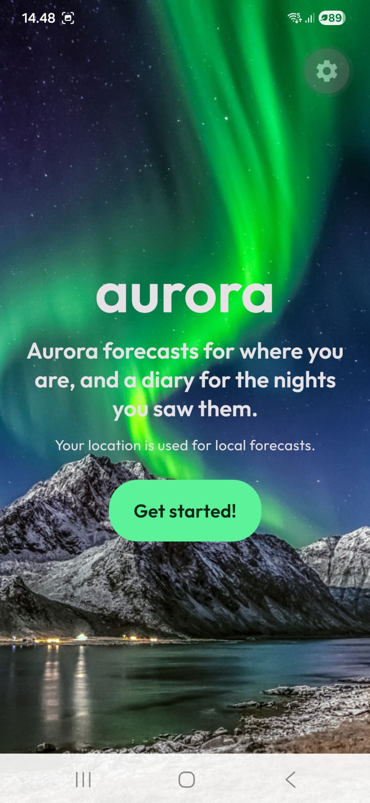
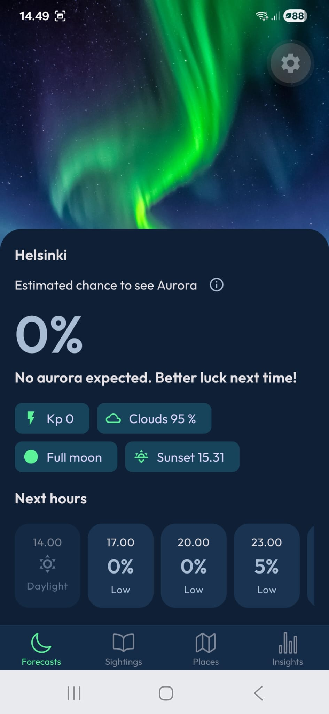
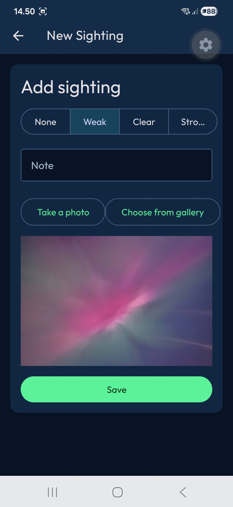
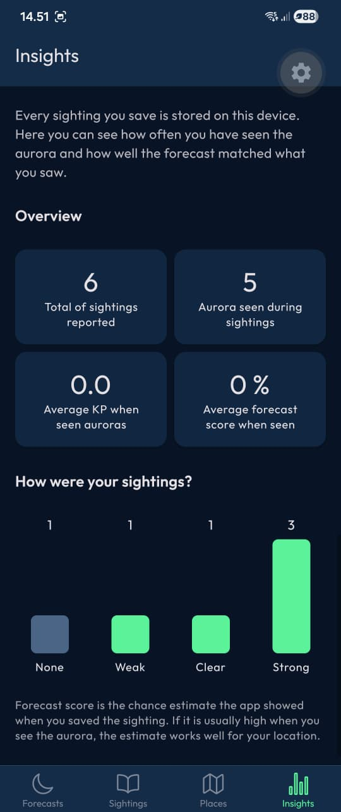

# Aurora application

Northern lights forecast and diary for your sightings.

## Screenshots

|  |  |
|  |  |
|  |  |

## Features

- **Forecast**: an estimated chance percentage for tonight, with hourly forecast for the next hours and the best times for upcoming days
- **Transparent score**: an info dialog shows each factor behind the number and which one limits it the most
- **Sighting diary**: save a rating, note and photo together with the conditions at the current moment
- **Places**: a map of all the places where you have saved sightings
- **Insights**: how often you saw the aurora, the average Kp, and how well the forecast score matched your sightings
- **Welcome screen**, shown only on the first launch

## How the score works

The chance percentafe is an estimate, not an official forecast. It combines four things: each is scored 0–100 % and they are multiplied, so one weak factor can pull the whole result down.

| Factor | Based on |
|---|---|
| Kp index | Current or forecast Kp compared to the Kp needed at your latitude (about 5 at 60°N, about 2 at 66°N) |
| Cloud cover | Cloud cover of the hour |
| Darkness | 0 in daylight, 1 between sunset and sunrise |
| Moon | A bright moon dims the sky by up to 30 % |

## Tech stack

- React Native with Expo (SDK 58) and TypeScript
- React Navigation (native stack and bottom tabs)
- React Native Paper (Material Design 3, custom dark theme and Outfit font)
- expo-sqlite for the sighting database and the "seen the welcome screen" flag
- expo-location, expo-image-picker, expo-file-system, expo-image
- react-native-webview with Leaflet for the map

## Data sources

- [NOAA Space Weather Prediction Center](https://www.swpc.noaa.gov/): planetary Kp index and its 3-day forecast
- [Open-Meteo](https://open-meteo.com/): cloud cover, sunrise and sunset, moon phase
- [OpenStreetMap](https://www.openstreetmap.org/copyright) map

## Project structure

```
App.tsx          app entry, providers and navigation
theme.ts         colors and fonts
Tabs.tsx         bottom tab navigation
types.ts         shared TypeScript types
strings.ts       user-facing messages
screens/         one file per screen
components/      reusable parts of the forecast screen
api/             NOAA and Open-Meteo requests
db/              SQLite queries
hooks/           useLocation
utils/           score, forecast, time, moon and statistics logic
```

## Current limitations

- The forecast and map need an internet connection
- The score uses simplified rules and has not been validated against real sightings
- Without location permission the app shows Rovaniemi
- Deleting a sighting does not delete its photo file from the phone

## Possible future improvements

- Red night mode for outdoors use
- Notifications when the chance of viewing is high
- A comparison of forecast score and sightings over time

## Credits

- Welcome & forecasts screen photo: Stein Egil Liland, Pexels
- Sighting photos: my own
- Fonts: Outfit (SIL Open Font License)
- Map: © OpenStreetMap contributors, Leaflet
- Weather data by Open-Meteo.com